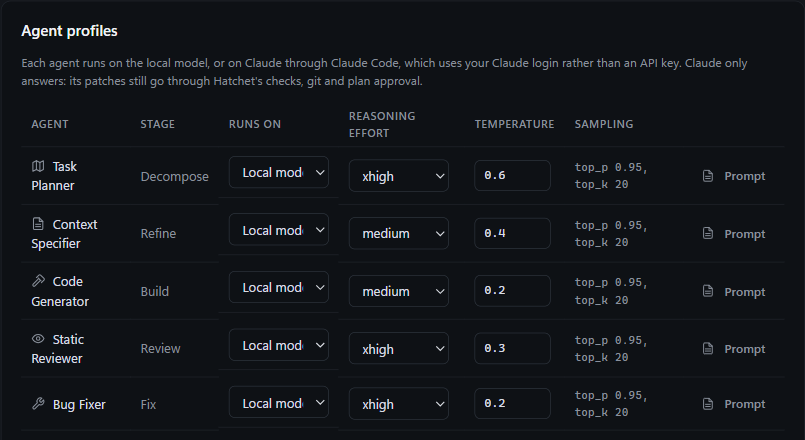

# Hatchet

**A local software factory.** Give it an architecture spec and a Git repository. A locally hosted model plans the work, writes it, tests it, reviews it and commits it, one subtask at a time. Anything it can't finish comes back to you.

Hatchet is for people who want to put a local model (it's built around Qwen 3.8, served by LM Studio or Ollama) to work on real repositories, with the checks that make that safe: a clean working tree, a separate branch, your own build and test command as the gate, and a human at every decision that matters.

> **Status:** an early, personal project that is now public. It works and has an automated test suite, but expect rough edges. It is developed and used on Windows. The code has Linux and macOS paths, but they haven't had much use, so reports are welcome. Please read [Safety](#safety) before pointing it at a repository.

## What you get

- **A planner you can overrule.** Hatchet splits your spec into ordered subtasks and shows you the plan. Approve, edit or reorder it before anything is built.
- **Your tests are the judge.** Every subtask must pass your build and test command before a reviewer sees it. Failures go to a fixer, with a budget.
- **One commit per subtask**, on a `factory/run-N` branch. Nothing merges until you click Merge, and nothing is pushed.
- **Stuck work comes back to you.** When a subtask runs out of attempts, or the model server goes away, the run pauses and asks. You can give guidance, fix it by hand and re-verify, skip it, or cancel.
- **Claude as a backup, or as the whole crew.** Any agent can run on Claude through the Claude Code CLI, which uses your Claude login, not an API key. By default, fixes the local model can't land escalate to Claude.
- **Built for small-model failure modes.** It catches runaway repetition, trims prompts that don't fit the context window, feeds agents real type signatures from your repo and packages, and keeps fixes from routing around the spec. See [how it works](docs/how-it-works.md).
- **Drivable from Claude Code.** Hatchet is also an MCP server, so you can plan a change with Claude and have your local model build it. See [docs/mcp.md](docs/mcp.md).

## Quick start

You need:

- The [.NET SDK](https://dotnet.microsoft.com/download) (9 or 10) and Git. The web app carries its own ASP.NET Core 9 runtime, so nothing else needs installing.
- A model served over an OpenAI-compatible API. See step 1 below.
- Optional: the [Claude Code](https://claude.com/claude-code) CLI, if you want any agent to run on Claude.

1. **Serve the model.**
   - **LM Studio:** load Qwen 3.8 and start the local server (`http://localhost:1234/v1`).
   - **Ollama:** run the model (`http://localhost:11434/v1`). Set `OLLAMA_CONTEXT_LENGTH=32768` or higher, because a small default silently truncates long prompts.
2. **Get and start Hatchet.**

   ```bash
   git clone https://github.com/crousky/hatchet.git
   cd hatchet
   dotnet run --project src/Factory.Web
   ```

   Then open http://localhost:5199. On Windows, `./run.ps1` does the same and opens your browser for you.
3. **Connect the model.** In **Settings**, pick your server and press **Test**. Choose the model ID your server actually reports. The default is `qwen3.8`, and servers often name it differently.
4. **Start a run.** In **New run**, paste or upload your spec, point at a clean Git repository, and set the verification command, or leave it on automatic detection.

New to this? Try a small, throwaway repository first, so you can watch a whole run before trusting it with anything you care about.

### What makes a good spec

Hatchet works from an architecture spec: a markdown document describing the structure, stack and behaviour you want. The more exact it is, the better the plan. Hatchet's own [original design spec](docs/original-design-spec.md) is an example of the kind of document it was built from.

## How a run works

| Stage | Agent | Effort | Temp | What happens |
| :--- | :--- | :--- | :--- | :--- |
| Ingest | | | | Scans the repo into a lightweight map. |
| Decompose | Task Planner | `xhigh` | 0.6 | Splits the spec into ordered subtasks. You can approve, edit or reorder them. |
| Refine | Context Specifier | `medium` | 0.4 | Reads the relevant files and writes exact signatures, test cases and edge cases. |
| Build | Code Generator | `medium` | 0.2 | Writes the code and tests on a `factory/run-N` branch. |
| Verify | | | | Runs your command. A failure goes to the Fixer, and the Reviewer doesn't run until it passes. |
| Review | Static Reviewer | `xhigh` | 0.3 | Checks the diff against the refined spec. Approval commits as `feat(subtask): ...`. |
| Fix | Bug Fixer | `xhigh` | 0.2 | Runs only after a failed Verify or a rejected Review. Gets 3 attempts before the first review, and 3 more after it. |
| Integrate | | | | Runs the full check once more, then offers one-click merge or a PR draft. If it fails, the Bug Fixer gets the errors as one more subtask, "Make the final check pass", which is reviewed and committed as `fix(integrate): ...`. |

Roles differ by system prompt, JSON schema, temperature and `reasoning_effort`, all of which can be changed in Settings:



Each role runs on the local model by default, or on Claude through the Claude Code CLI. When a fix fails on the local model, the next attempt goes to Claude, and so does a local fix still running after 90 minutes. While any agent is working, you can stop its call and hand it to another model from its card in the agent pane.

Once three subtasks are done, the run header shows a likely range for the working time left. It's based on how long the finished subtasks took, and time paused doesn't count. It narrows as more subtasks finish.

Retries are automatic. Before it asks you, Hatchet makes one last fix on Claude Opus once the normal attempts are used (unless the Bug Fixer is already on Opus, or Claude fixes are switched off). It also stops early when two fixes in a row end in the same error, because that usually means the cause is outside the code, such as a missing download. Fixes the spec guard refuses don't use up attempts, though a run of them still stops the subtask.

If a subtask runs out of attempts, or the model server goes away, the run pauses and asks you what to do. You can retry with your own guidance, re-verify after fixing it by hand, restart the subtask, skip it, or cancel the run. Your guidance goes to every agent that works on the subtask from then on. Runs interrupted by a restart pause the same way and can be resumed.

## Ad hoc requests

Beside a repository's runs, you can ask Hatchet for one-off things. They're grouped under that repository on the Runs page, each with its own page showing live output, and you can stop, repeat or delete them.

- **Status report:** the branch, uncommitted changes, every run's progress, what each is doing now and what needs you. Built from Hatchet's own data, so it's instant and needs no model.
- **Run the app:** starts the latest commit, using the command Hatchet detects (dotnet, npm, cargo, go or python) or one you give. It keeps running until you stop it.
- **Run command:** the same, for any command, such as the tests.
- **Ask:** a free-form question, answered by Claude Code. It gets the status report and can read and search the repository's files, and nothing else.
- **Report a defect or change:** describe what's wrong, or what you want, and attach screenshots by pasting (`Ctrl+V`), dropping or choosing them. Claude Code reads the screenshots and the code, read-only, and writes up what it found. Hatchet then starts a run from that, which waits for you to approve its plan. You can pick the model for the whole run, any local model your server has or Claude Opus, Sonnet or Haiku, or leave it to Settings. If Claude finds nothing in the project to change, such as a bad install, it starts no run and tells you what to do instead.

Commands run in an isolated copy of the repository's latest commit (a git worktree under Hatchet's data folder), so they never disturb a run that is building in the same folder. The catch is that uncommitted work isn't in the copy. Only one command runs per repository at a time. The same requests are available to Claude Code over MCP; see [Claude Code and MCP](docs/mcp.md).

## Documentation

| Page | What's in it |
| :--- | :--- |
| [How it works](docs/how-it-works.md) | Keeping fixes to the spec, type definitions in prompts, runaway-answer handling, projects and the run queue |
| [Skills](docs/skills.md) | Write instructions once, and have the planner hand them to the agents that need them |
| [Claude Code and MCP](docs/mcp.md) | Plan with Claude, build with your local model |
| [Original design spec](docs/original-design-spec.md) | The spec Hatchet was first built from, kept for context |
| [Contributing](CONTRIBUTING.md) | Building, testing, adding migrations |

## Safety

**Hatchet runs model-written code on your machine, with no sandbox.** Verification executes whatever tests the model wrote, with your user's permissions. Use it on repositories you can afford to have changed, and in a VM or container if you want isolation.

What it does to limit the damage:

- **Clean tree required.** A run won't start with uncommitted changes, so rollbacks can't touch your work.
- **Separate branch.** Work stays on `factory/run-N`. Rollback refuses to run on any other branch, and nothing merges until you click Merge.
- **No unreviewed commands.** Verification commands proposed by Hatchet's planner only run if you approved them at plan review. Otherwise Hatchet runs your own command, or one it detects from the repository. A plan handed over through MCP counts as approved by whoever handed it over, but an MCP client can't approve commands proposed by Hatchet's planner.
- **Writes stay inside the repo.** A patch with an absolute path, a `..`, a symlink on the way, or a target in `.git` is rejected whole, before anything is written.
- **Local only.** The server binds to `localhost` and rejects other host names. The MCP endpoint also refuses requests from web pages other than Hatchet's own. It has no login, so don't expose it.
- **Nothing is pushed.** Prepare PR gives you the commands and the description, and you run them yourself.
- **Ad hoc requests are yours to start.** Running the app or a command executes the repository's code, or the command you typed, with your user's permissions, in an isolated copy of the latest commit. Questions run Claude Code with only the Read, Grep and Glob tools, from Hatchet's own folder, so the repository's hooks and settings aren't loaded. Reports work the same way, and only files whose contents are PNG, JPEG, GIF or WebP pictures are accepted as screenshots, so a path to some other file is refused.

Found a security problem? Please report it privately; see [CONTRIBUTING.md](CONTRIBUTING.md#reporting-security-issues).

## Where things live

- **Database:** `%LOCALAPPDATA%\Hatchet\hatchet.db` on Windows, under `~/.local/share/Hatchet` on Linux. Set `ConnectionStrings__Factory` to move it.
- **Your own skills:** the `skills` folder next to the database. See [Skills](docs/skills.md).
- **Ad hoc copies:** the `adhoc` folder next to the database, one folder per repository and commit. Deleting the requests that used a copy removes it.
- **Screenshots:** the `attachments` folder next to the database, one folder per report. Deleting the report removes them.
- **Port:** `http://localhost:5199`, set by `Urls` in `src/Factory.Web/appsettings.json`.

Keyboard: `Ctrl+B` toggles the subtask pane, `Ctrl+Alt+B` the agent pane, `Ctrl+J` the terminal panel. Pane edges can be dragged to resize.

## Project layout

```
LocalSoftwareFactory.sln
src/Factory.Contracts   Domain models, DTOs, state enums, strict JSON schemas
src/Factory.Engine      LLM client, Git workspace, command runner, skills, orchestrator
src/Factory.Web         Blazor Server UI, SQLite persistence (EF Core)
tests/Factory.Tests     xUnit tests, including full pipeline runs against real Git repos
```

To build and test, see [CONTRIBUTING.md](CONTRIBUTING.md).

## License

[MIT](LICENSE). Hatchet runs model-written code on your machine, so read [Safety](#safety) first.
